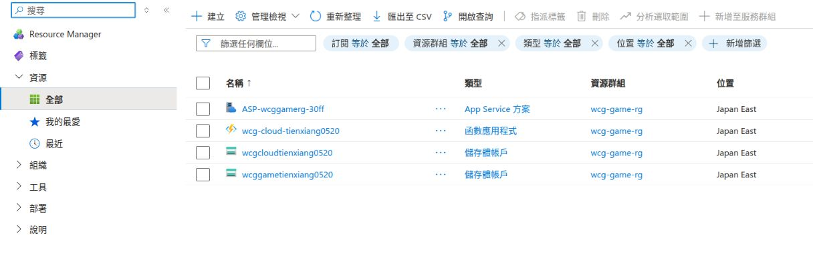
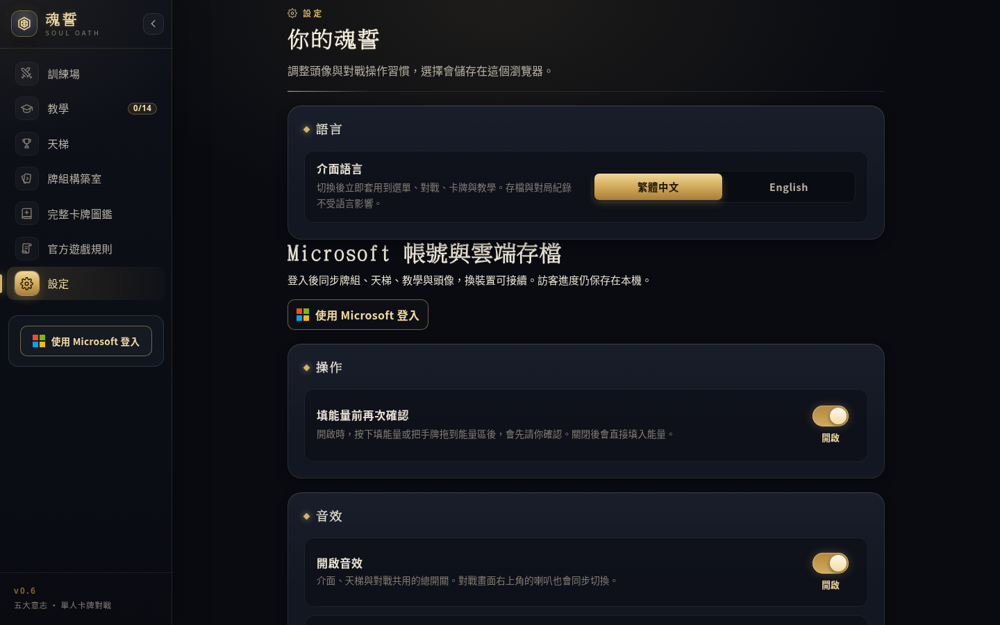
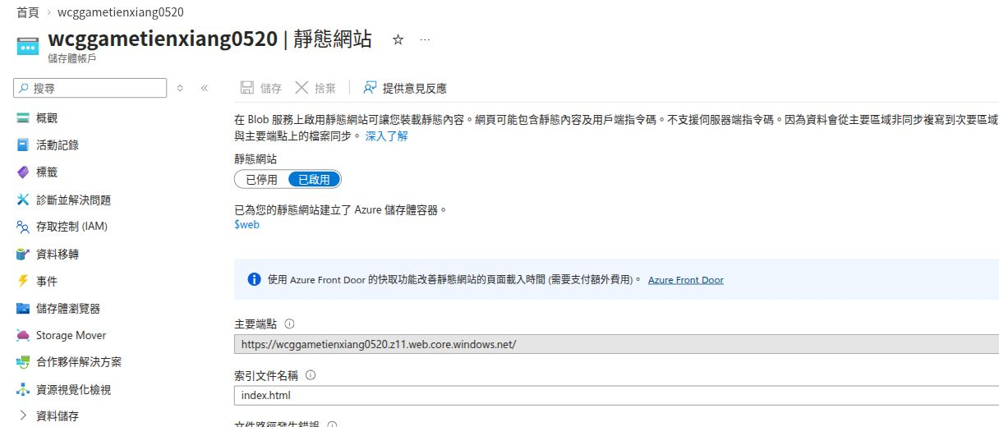
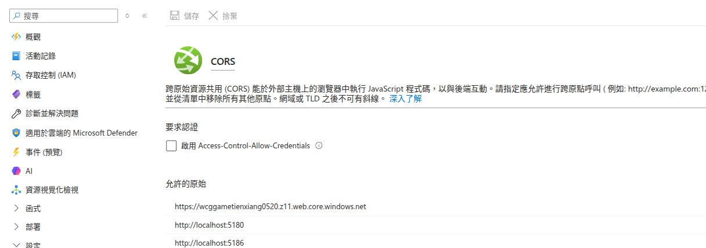
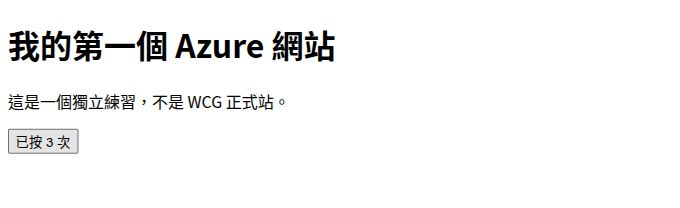

# WCG 專案自學與 Azure 操作教學

適用專案：`/home/pudding/project/WCG`。核對日期：2026-10-13。

這份教材帶你親手走完「找到程式 → 改一小段 → 本機看效果 → 檢查 → 保存版本 → 更新 Azure」。你不用一開始就讀懂整款遊戲；每課完成一個可觀察的小成果即可。

本機操作以 Ubuntu、VS Code、Bash 為例。下方所有指令，除另有標示，都在專案根目錄的終端機執行。Azure 畫面可能改版；選單找不到時，使用資源左側的搜尋方塊找相同功能。

## 學習順序

| 順序 | 學會的事情 | 完成標準 |
| --- | --- | --- |
| 1 | 分清楚程式、建置檔案與玩家資料 | 知道四個 Azure 資源各自的用途 |
| 2 | 使用編輯器及 Git | 能找到檔案、比較修改、只提交自己的變更 |
| 3 | 修改設定頁文字 | 本機能看到新標題，中英文都正常 |
| 4 | 修改卡牌數值 | 在本機圖鑑看到新數值，知道能力文字與實際效果分開 |
| 5 | 閱讀 C# 天梯規則 | 能解釋為什麼只有青銅保護，並執行相關測試 |
| 6 | 更新正式網站 | 能驗證輸出，再把完整建置結果發布到原網站 |
| 7 | 閱讀與調整 Azure 設定 | 找得到網站網址、私人容器、CORS 與登入回跳設定 |
| 8 | 建立自己的練習網站 | 使用獨立資源群組上傳一個小 HTML 網站 |

建議先完成第 3 課的文字修改，再學發布。第 4 課的卡牌改動先留在本機；正式改卡還要處理舊對局的相容性。

## 第 1 課：這個專案怎麼運作

### 1.1 從玩家按下按鈕開始理解

玩家開啟正式網址，Azure 提供遊戲檔案。C# 遊戲規則以 WebAssembly 在玩家的瀏覽器執行；TypeScript／Phaser 負責戰場畫面和互動。玩家操作會先存到自己的瀏覽器，登入 Microsoft 後，再同步到私人雲端。

```text
瀏覽器下載網站 ← wcggametienxiang0520（公開網站檔案）
      │
      ├─ C#／Blazor：畫面、卡牌規則、AI、天梯
      ├─ TypeScript／Phaser：戰場顯示與滑鼠操作
      ├─ localStorage：訪客進度、各帳號本機快取
      │
      └─ Microsoft 登入 → 存檔 API → wcgcloudtienxiang0520
                              ↑         私人玩家資料
                      wcg-cloud-tienxiang0520
                      執行方案：ASP-wcggamerg-30ff
```

這是流程示意圖，不是 Azure 操作截圖。

「靜態網站」不代表遊戲只能顯示固定文字，而是 Azure 網站主機只供應檔案，遊戲運算放在瀏覽器。雲端存檔另由 API 處理。

### 1.2 目前四個 Azure 資源

Azure 首頁按「檢視所有資源」，或從「所有資源」進入 Resource Manager 的「全部」。這是清理舊主機後的實際清單：



| 名稱 | 作用 | 放什麼／負責什麼 |
| --- | --- | --- |
| `wcggametienxiang0520` | 公開網站儲存體 | `$web` 中的遊戲程式、卡圖、音效和公開資料 |
| `wcgcloudtienxiang0520` | 私人玩家儲存體 | `player-saves` 容器中的玩家進度 |
| `wcg-cloud-tienxiang0520` | Azure Functions 存檔 API | 驗證 Microsoft 身分、檢查存檔、讀寫私人資料 |
| `ASP-wcggamerg-30ff` | Function 的 Flex Consumption 執行方案 | 決定 API 如何使用運算資源；由 Azure 管理 |

`wcg-game-rg` 是資源群組，可以想成這些資源共同放置的管理資料夾。刪除資源群組會連同其中的資源一起刪除。

舊網站 `wcg-game-tienxiang0520` 及舊方案 `ASP-wcggamerg-a454` 已在本次對話中刪除。注意有連字號的舊名稱與沒有連字號的現用網站儲存體不同。

### 1.3 三種版本不要混在一起

| 東西 | 在哪裡 | 改了之後會怎樣 |
| --- | --- | --- |
| 原始碼 | `.cs`、`.razor`、`.ts`、原始 `.json` | 需要重建，正式站才會拿到新程式 |
| 建置輸出 | `.build-tmp/learning-site/dist` 等目錄 | 可本機預覽，也可上傳到 Azure |
| 玩家資料 | 瀏覽器、私人 Blob、本機存檔與備份 | 不應被拿來當網站檔案上傳或清理 |

Git 保存程式版本；Azure Storage 保存部署檔案或玩家資料。`git push` 與「更新 Azure 網站」是兩個不同動作，目前沒有由本教材新增自動部署。

### 1.4 要改什麼，先找哪裡

下列都是專案根目錄下的相對路徑。

| 想改的內容 | 先讀這裡 |
| --- | --- |
| 正式靜態版設定頁 | `SoulOath.Static/Components/Pages/Settings.razor` 及同名 `.razor.css` |
| 側邊選單 | `WcgWeb/Components/Layout/NavMenu.razor` |
| 一般遊戲畫面 | `WcgWeb/Components/Pages/`、`WcgWeb/Components/Common/` |
| 畫面的英文翻譯 | `WcgWeb/i18n/en.json` |
| 卡牌數值與卡文 | `WcgWeb/Data/cards.json` |
| 卡牌英文 | `WcgWeb/i18n/cards.en.json` |
| 能力真的如何結算 | `WcgWeb/Services/GameEngine*.cs`，例如 `GameEngine.Effects.cs` |
| 天梯星數、牌位、月重置 | `WcgWeb/Models/Ranked/RankedProfile.cs` 裡的 `RankedRules` |
| 天梯續局與結算 | `WcgWeb/Services/RankedSession.cs` |
| 戰場動畫、拖曳、操作 | `WcgWeb/Client/battle/` 的 TypeScript |
| Microsoft 登入 | `WcgWeb/Client/cloud/` |
| 自動同步與帳號快取 | `SoulOath.Static/wwwroot/cloud.js`、`cloud-sync.js` |
| 雲端帳號介面 | `WcgWeb/Components/Common/CloudAccountPanel.razor` |
| 存檔 API | `Wcg.Cloud/` |
| 遊戲測試／API 測試 | `WcgTests/`／`Wcg.Cloud.Tests/` |
| 前端建置／網站發布 | `SoulOath.Static/tools/build-site.mjs`／`deploy-blob.py` |
| API 建置／發布 | `tools/CloudSave/deploy_api.py` |

`WcgWeb` 保留原 ASP.NET Core 伺服器入口；正式站用 `SoulOath.Static`，並共用很多 `WcgWeb` 的元件、模型與服務。**設定頁有兩份入口，這份教材改的是 `SoulOath.Static` 那份。**

`SoulOath.Static.csproj` 中的 `RazorComponent Include`、`Compile Include` 是共用來源的連結，所以不要把共用檔案複製成另一份來改。

## 第 2 課：準備編輯環境與 Git

### 2.1 開啟專案

```bash
cd /home/pudding/project/WCG
code .
```

在 VS Code：左側檔案總管找檔案；`Ctrl+P` 輸入檔名；`Ctrl+Shift+F` 搜尋整個專案；`Ctrl+S` 儲存；`Ctrl+Shift+P` 開命令選單，搜尋「Terminal: Create New Terminal」開終端機。讀這份教材時可用 `Ctrl+Shift+V` 開 Markdown 預覽。

先檢查工具，不用先重裝：

```bash
dotnet --version
node --version
npm --version
python3 --version
git --version
```

本次實際使用 .NET SDK `10.0.112`、Node.js `v26.8.1`、Python `3.14.4`。專案目標是 .NET 10；版本日後可能更新。建置準備圖片還需要 Pillow；檢查方式是 `python3 -c 'from PIL import Image; print(Image.__version__)'`。

### 2.2 改之前先看狀態

```bash
git status --short
git diff
```

`M` 是已修改，`??` 是 Git 尚未追蹤的新檔案。這台電腦可能已有你自己正在修改的 `README.md`、`docs/設計待討論.md` 或 `cards.ods`，不要把它們當垃圾或順手一起提交。

建立自己的練習分支：

```bash
git switch -c learn/settings-text
```

已經在這個分支就不用再建立；可用 `git branch --show-current` 確認。新分支會帶著目前未提交的修改，不會自動替你把它們保存成版本。先辨認哪些是自己的工作，不要為了切換而強制清除。

### 2.3 保存一次完成的小修改

做完第 3 課後才執行：

```bash
git diff -- SoulOath.Static/Components/Pages/Settings.razor WcgWeb/i18n/en.json
git add SoulOath.Static/Components/Pages/Settings.razor WcgWeb/i18n/en.json
git diff --cached
git commit -m "Adjust settings page title"
git log --oneline -5
```

`add` 選擇這次要保存的檔案；`diff --cached` 檢查即將提交的內容；`commit` 建立版本。這裡刻意列檔案，不用 `git add .` 把不相關的工作一起提交。

這個主專案目前有 GitHub 遠端 `origin`。想把練習分支也保存到遠端時：

```bash
git remote -v
git push -u origin learn/settings-text
```

推送分支不會更新 Azure 網站。`.runtime/`、玩家備份、`local.settings.json`、`.env` 及建置結果都不應提交；`SoulOath.Site/` 有獨立的 Sites Git，不是目前 Azure 部署目錄。

## 第 3 課：第一個修改——設定頁標題

目標：把設定頁的「你的魂誓」改成「我的魂誓設定」。先做畫面文字，不會變更遊戲規則。

### 3.1 找到畫面來源

```bash
rg -n '你的魂誓' SoulOath.Static/Components/Pages/Settings.razor WcgWeb/i18n/en.json
```

打開 `SoulOath.Static/Components/Pages/Settings.razor`，找到：

```razor
<h1>@L["你的魂誓"]</h1>
```

手動改成：

```razor
<h1>@L["我的魂誓設定"]</h1>
```

`<h1>` 是 HTML 標題；`@` 表示 Razor 要執行 C# 表達式；`L[...]` 是這個專案的翻譯查詢。這不是直接寫死一段中文。

### 3.2 補上英文翻譯

打開 `WcgWeb/i18n/en.json`，在最外層 JSON 物件中新增一項：

```json
"我的魂誓設定": "My Soul Oath Settings",
```

這是要插入物件的一行，不是完整 JSON 檔。可以放在原本 `"你的魂誓": "Your Soul Oath",` 附近。保留舊項目，其他元件可能還使用它。最後一個項目不能有多餘逗號。

檢查 JSON 與翻譯測試：

```bash
python3 -m json.tool WcgWeb/i18n/en.json > /dev/null
dotnet test WcgTests/WcgTests.csproj --nologo --filter 'FullyQualifiedName~LocalizationTests'
```

第一個指令沒有輸出且沒有錯誤，代表 JSON 可解析。第二個指令應顯示測試通過；若新增字串缺少翻譯，不要靠刪掉測試來讓它通過。

### 3.3 建立獨立的本機預覽

```bash
node SoulOath.Static/tools/build-site.mjs .build-tmp/learning-site --azure
node SoulOath.Static/tools/serve-static.mjs .build-tmp/learning-site/dist 5186
```

第二個指令持續執行才有預覽網站。打開 [本機設定頁](http://127.0.0.1:5186/settings)。終端機按 `Ctrl+C` 只停止這次預覽。

5180 是既有預覽，教材使用 5186，避免改到原本正在看的版本。若 5186 顯示 `EADDRINUSE`，代表已有服務占用；先辨認是什麼服務，不要直接關閉不認識的程序。可先用另一個空閒埠看訪客版，但 Microsoft 登入需要另行登記該來源及回跳網址，見第 7 課。

先以訪客模式練習，避免試驗規則時改到自己的雲端對局。第一次載入要等遊戲資源下載；看到預覽伺服器啟動訊息，還不等於畫面已驗證成功。

修改後要重新執行建置指令，然後重新整理頁面。建置目錄屬於練習站，不覆蓋 `.build-tmp/v06-site/dist` 的現有預覽。

### 3.4 自己驗收

- 繁體中文顯示「我的魂誓設定」。
- 切 English 後顯示「My Soul Oath Settings」。
- 按 `F12`，Console 沒有新的紅色錯誤。
- 使用裝置模式看約 390 px 寬度，文字與按鈕沒有超出畫面。
- 原本的設定開關和備份工具仍可操作。

這是原版正式站的實際畫面，可用來辨認你要改的區域；教材並未把練習標題直接改上正式站：



做完後用第 2 課的 Git 指令保存。能完成這一課，你就已經走完一次「改 C#／Razor 畫面來源、補翻譯、建置、預覽、驗收」的流程。

## 第 4 課：卡牌資料與效果程式有什麼不同

這一課只使用訪客本機預覽，完成後把練習數值改回來，再重新建置。不要把這個練習直接發布為平衡更新。

### 4.1 看懂一張卡

`WcgWeb/Data/cards.json` 是陣列，每個物件是一張卡。以 `WCG-001` 為例，以下是目前資料的節錄：

```json
{
  "id": "WCG-001",
  "name": "赤誓殘酷監工",
  "type": "怪物",
  "will": "狂怒",
  "cost_spec": "",
  "cost_gen": 2,
  "total_cost": 2,
  "pp": 1000,
  "dp": 1,
  "text": "進場：抉擇：消滅 1 隻 PP 500 以下的敵方怪物；或抽 1 張牌，然後棄 1 張手牌。"
}
```

這是欄位節錄，不要用它取代整個檔案或刪掉其他欄位。

| 欄位 | 意義 |
| --- | --- |
| `id` | 穩定的卡牌識別碼；牌組、卡圖與效果程式都依賴它 |
| `name` | 卡名 |
| `cost_spec`、`cost_gen`、`total_cost` | 專色、通用及總費用；改費用要維持三者一致 |
| `pp` | 力量，怪物交戰比較會使用 |
| `dp` | 對玩家造成的傷害數值 |
| `text` | 玩家看見的能力說明 |
| `keywords`、`arrows` | 關鍵字與箭頭方向，可能直接影響規則 |

**改 `text` 不會自動創造或修改能力。** 例如卡文的「PP 500 以下」也有對應的 C# 判斷，不能只改字面就當作效果門檻已改。

```bash
rg -n 'WCG-001' WcgWeb/Services WcgWeb/i18n/cards.en.json
```

目前效果入口可在 `GameEngine.Effects.cs` 找到，AI 的判斷也會出現在其他 `GameEngine` 檔案。真正改能力，還要核對目標選擇、結算、AI、英文、規則說明與測試。

### 4.2 親手改一個數值

在 `WCG-001` 那個物件中，將 `"pp": 1000` 改成 `"pp": 1100`；不要搜尋後全檔取代所有的 1000。

```bash
python3 -m json.tool WcgWeb/Data/cards.json > /dev/null
python3 tools/CardDocs/build_cards_md.py
python3 tools/CardDocs/build_cards_md.py --check
git diff -- WcgWeb/Data/cards.json cards.md
node SoulOath.Static/tools/build-site.mjs .build-tmp/learning-site --azure
```

`cards.md` 由工具產生，應改 JSON 後再產生，不能只手改卡牌總表。重建後開 [本機圖鑑](http://127.0.0.1:5186/cards)，找 `WCG-001`，確認顯示 1100 PP；再看列印預覽的數值。

卡面文字與數值由 `CardFace.razor` 讀資料繪製；卡圖檔案是插畫資源，不需要為這次 PP 練習改圖片。原始插畫在 `WcgWeb/wwwroot/card-art/`，WebP 與列印 JPG 會由準備工具產生。

### 4.3 為什麼改卡比改標題多一步

天梯存檔保存卡池指紋、種子和操作紀錄。既有 `RankedSession` 和 `CardBalanceHistory` 會用歷史卡池續玩、重播舊對局。新增一次卡牌平衡改動，不能假設只改 `cards.json` 就保證所有舊局相容；雲端 API 也會重新驗證存檔。

正式改卡需要先設計新的一段歷史卡池支援，參考：

- `WcgWeb/Services/CardBalanceHistory.cs`：如何還原不同時期的卡池。
- `WcgWeb/Services/RankedSession.cs` 的 `priorEras`：如何辨識舊對局。
- `build/Wcg.SharedResources.props`：網站、API 共用哪些歷史資料。
- `WcgTests/RankedTests.cs`：既有對局在改版後續玩與回顧的測試。

這是進階工作。先把本次練習的 PP 改回 1000，重產 `cards.md`、重建本機站，確認圖鑑恢復。從 `git diff` 確認卡牌資料沒有留下練習變更。沒有必要靠刪玩家存檔來解決相容問題。

## 第 5 課：讀懂 C#——只有青銅牌位保護

### 5.1 找到實際規則

```bash
rg -n 'static int Tier|static int Apply' WcgWeb/Models/Ranked/RankedProfile.cs
rg -n 'StarProgressProtectsOnlyBronze' WcgTests/RankedTests.cs
```

目前 `RankedRules` 裡面是：

```csharp
public static int Tier(int stars) => Math.Min(5, Math.Max(0, stars) / 15);
public static int Apply(int stars, bool won) => won ? stars + 1 : Tier(stars) == 0 ? stars : stars - 1;
```

`int` 是整數；`bool` 是真或假；`static` 表示可以透過類別呼叫；`return` 是傳回結果；`=>` 在這裡是用單一表達式實作方法。`條件 ? 成立時結果 : 不成立時結果` 叫條件運算子。

`Tier` 用整數除法：0～14 星是 0，也就是青銅；15～29 是白銀；到 75 星以上都算大師。`Math.Max` 避免負數牌位，`Math.Min` 限制最高牌位索引。

把 `Apply` 展開成比較好讀的寫法，行為完全相同：

```csharp
public static int Apply(int stars, bool won)
{
    if (won)
    {
        return stars + 1;
    }

    if (Tier(stars) == 0)
    {
        return stars;
    }

    return stars - 1;
}
```

你可以只將原本那一個 `Apply` 方法改成上面版本，作為 C# 閱讀練習。不要新增第二個同名方法。這次重寫不應改變任何天梯結果。

### 5.2 用案例理解，而不是只看畫面文字

| 起始星數 | 勝負 | 結果 | 原因 |
| ---: | --- | ---: | --- |
| 14 | 敗 | 14 | 青銅保護 |
| 14 | 勝 | 15 | 升到白銀 |
| 15 | 敗 | 14 | 白銀不保護，可以降回青銅 |
| 30 | 敗 | 29 | 黃金不保護 |
| 75 | 敗 | 74 | 大師不保護 |

測試中 `[InlineData(15, false, 14)]` 的意思是「輸入 15 星、敗北，預期 14 星」。`Assert.Equal` 比較預期值與真正執行的結果。

```bash
dotnet test WcgTests/WcgTests.csproj --nologo --filter 'FullyQualifiedName~StarProgressProtectsOnlyBronze'
```

改成多行方法後，結果仍應全部通過。若將 `Tier(stars) == 0` 誤改成 `<= 1`，白銀敗北的測試就會失敗，因為實作變成了白銀也保護。這就是測試能抓到、但改畫面說明抓不到的問題。

若真的改遊戲規則，還要同步 `規則.md`、網站的 `GameRulesContent.razor`、英文和相關說明。展開同一個方法、行為不變，則不需要改規則說明。

## 第 6 課：把修改更新到目前 Azure 網站

這一課用第 3 課的文字修改練習發布。發布前請先完成 Git 保存與本機驗收；確認第 4 課的 PP 練習已還原。

### 6.1 先分清楚要發布哪個部分

| 修改內容 | 要更新什麼 |
| --- | --- |
| Razor、CSS、介面翻譯、Phaser 前端 | 靜態網站 |
| `Wcg.Cloud` 裡的 API | 存檔 API |
| 卡池、共用天梯還原或備份驗證邏輯 | 靜態網站與 API；先確認資料相容性 |
| Microsoft 回跳網址、CORS | Azure／Entra 設定；網址或前端設定有變時也更新網站 |
| 只有 `docs/` 教材 | Git 文件，不需要部署遊戲 |

`.cs` 是 C# 原始碼；網站會下載編譯後的 WebAssembly。把 `.cs` 或整個專案資料夾丟進 `$web`，不會讓程式自動編譯。

### 6.2 Azure CLI 是什麼

Azure 入口網站適合看資源、改設定。Azure CLI 是在終端機操作同一批 Azure 資源的工具；本專案發布腳本用它確認帳號、目標資源及取得必要授權。

這台電腦的工具放在 Python 虛擬環境，先設定：

```bash
cd /home/pudding/project/WCG
export AZURE_CONFIG_DIR=/home/pudding/project/WCG/.runtime/azure-cli-config
WCG_AZ=/home/pudding/project/WCG/.build-tmp/azure-cli/bin/az
WCG_AZ_PYTHON=/home/pudding/project/WCG/.build-tmp/azure-cli/bin/python
"$WCG_AZ" --version
"$WCG_AZ" account show --query '{Name:name,State:state}' -o table
```

這些變數只在目前的終端機有效。登入資料在 `.runtime/`，不用放進程式或 Git。

若工具目錄不存在，例如換到新電腦，才建立環境、安裝官方套件：

```bash
mkdir -p .build-tmp
python3 -m venv .build-tmp/azure-cli
.build-tmp/azure-cli/bin/python -m pip install azure-cli azure-storage-blob
```

`pip` 從 Python 套件登錄安裝工具；它不是登入 Azure。若 `venv` 不可用，依 Ubuntu 的提示補上對應 Python venv 套件；不要用 `sudo pip` 改全系統套件。安裝後重新執行上面的變數設定。

需要登入時由你本人完成：

```bash
"$WCG_AZ" login --use-device-code
"$WCG_AZ" account set --subscription 'Azure for Students'
"$WCG_AZ" resource list -g wcg-game-rg --query '[].{Name:name,Type:type}' -o table
```

如果你有同名訂閱，用 Azure 入口網站查到的訂閱 ID 指定。登入成功應能列出目前四個現用資源；密碼、驗證碼、存取權杖都不需要貼到程式或教材。

### 6.3 先建置和檢查，這一步不發布

```bash
dotnet test WcgTests/WcgTests.csproj --nologo
python3 tools/CardDocs/build_cards_md.py --check
python3 SoulOath.Static/tools/test-deploy-blob.py
node SoulOath.Static/tools/build-site.mjs .build-tmp/learning-site --azure
python3 SoulOath.Static/tools/deploy-blob.py .build-tmp/learning-site/dist
```

最後一個指令沒有 `--publish`，只驗證公開檔案。看到 `Validated:` 表示資源清單、SHA-256、卡牌與路由等部署條件通過，**不代表正式網站已更新**。若前面失敗，先修正，不要直接跳到上傳。

建置會重建 `learning-site/dist`、產生資源清單及路由頁面。這是可重建的輸出目錄，不能拿它當存檔或練習程式的保存位置。

### 6.4 發布到現有網站

這個指令會真正修改正式網站的公開檔案：

```bash
"$WCG_AZ_PYTHON" SoulOath.Static/tools/deploy-blob.py \
  .build-tmp/learning-site/dist \
  --publish \
  --az "$WCG_AZ" \
  --record .runtime/azure-blob-deployment.json
```

腳本預設目標就是 `wcggametienxiang0520`、`wcg-game-rg`，不會另外建立新網站。它先上傳並核對資源，再發布清單與 HTML，保留既有資源供開著的舊分頁使用。再次執行會比較遠端檔案，跳過相同內容。

儲存金鑰只在發布程序的記憶體中使用，不寫進網站或部署收據。`.runtime/azure-blob-deployment.json` 記錄網址、版本與檔案數，不是玩家存檔。

### 6.5 正式站驗收

開啟 [正式設定頁](https://wcggametienxiang0520.z11.web.core.windows.net/settings)，重新整理，等待更新資源下載，重做第 3 課的中英文與手機檢查。再看 [圖鑑](https://wcggametienxiang0520.z11.web.core.windows.net/cards)、[天梯](https://wcggametienxiang0520.z11.web.core.windows.net/ranked) 是否能開啟。

如果有使用 Microsoft，確認自己的進度仍在、狀態顯示「雲端已同步」。本機網址與正式網址的訪客進度彼此獨立；不要因為本機有牌組就以為正式站的訪客資料也會自動搬過去。

上傳完成、HTTP 200、本機能開啟，各只能證明一部分。真正驗收要在正式網址看到你改的標題，且原功能仍可用。

### 6.6 API 的更新方式

只改設定頁不用發布 API。若改了 `Wcg.Cloud` 或 API 使用的共用來源：

```bash
dotnet restore Wcg.Cloud/Wcg.Cloud.csproj
dotnet test Wcg.Cloud.Tests/Wcg.Cloud.Tests.csproj --nologo
python3 tools/CloudSave/deploy_api.py
```

不加 `--publish` 只建立 API 套件、執行測試。需要正式更新時：

```bash
python3 tools/CloudSave/deploy_api.py --publish --az "$WCG_AZ"
```

這會更新既有 `wcg-cloud-tienxiang0520`，不建立新 Function。由於是預先編譯的 .NET isolated 專案，要在本機改 C#、測試、發布，不能靠 Azure 入口網站的程式碼編輯頁直接改這些組件。[官方說明](https://learn.microsoft.com/en-us/azure/azure-functions/functions-how-to-use-azure-function-app-settings)

健康檢查：開 [API health](https://wcg-cloud-tienxiang0520.azurewebsites.net/api/health)，應看到 JSON 的服務名稱與版本。直接開 `/api/save` 沒有登入權杖，應回 401；這代表身分保護有生效，不是網站壞掉。健康檢查不能取代登入後存檔的操作驗證。

## 第 7 課：在 Azure 入口網站查看與調整設定

先開 [Azure 入口網站](https://portal.azure.com/)，進「所有資源」。看設定不用重新建立資源；改畫面標題也不用改 Azure 設定。下面先做讀取練習，只有確定要換網址或新增服務時，才照修改步驟保存。

### 7.1 正式網站：首頁、網址、公開檔案

1. 點 `wcggametienxiang0520`。
2. 左側展開「資料管理」，點「靜態網站」；也可以在資源選單搜尋「靜態網站」。
3. 確認已啟用，索引文件名稱是 `index.html`，主要端點就是正式網址。
4. 「文件路徑發生錯誤」是自訂 404 頁面欄位，不是目前發生錯誤的訊息。本次畫面中此欄尚未設定；網站輸出已有 `not-found/index.html`；已補正部署工具的 SDK 欄位名稱，下次使用第 6 課的部署指令會設定此錯誤頁。
5. 左側「資料儲存」→「容器」，或使用「儲存體瀏覽器」，找到 `$web`，查看公開的網站檔案。



這是實際讀取的設定畫面；本教材拍攝時沒有變更首頁或啟用新的付費服務。入口網站中的 Front Door 提示是另外的服務，不是這個 WCG 網站正常運作的必要步驟。

Azure Storage 靜態網站使用 `$web` 放內容。練習的小 HTML 可以在入口網站上傳；正式 WCG 有資源清單、雜湊檢查、登入回跳頁和多個路由，更新時使用第 6 課的完整部署腳本，避免只手改一個已建置檔案造成版本不一致。[官方操作說明](https://learn.microsoft.com/en-us/azure/storage/blobs/storage-blob-static-website-how-to?tabs=azure-portal)

### 7.2 私人玩家資料：跟公開網站分開看

1. 回「所有資源」，點 `wcgcloudtienxiang0520`。
2. 找「容器」→ `player-saves`；容器的公開存取層級應是私人／None。
3. 玩家檔案路徑是 `players/身分雜湊/save.json`，不是用電子郵件當檔名。
4. 「資料管理」→「資料保護」查看版本功能；「生命週期管理」查看舊版本 7 天的清理規則。

`wcgcloud...` 裡是玩家資料，`wcggame...` 的 `$web` 裡是公開內容。學習上傳時，一定先確認資源名稱和容器名稱，避免放錯地方。

如果入口網站顯示沒有資料存取權限，這跟「能管理儲存體資源」是不同權限；不要因此把容器改成公開。管理者查看 Blob 資料可能需要額外的資料角色。[Blob 資料角色說明](https://learn.microsoft.com/en-us/azure/storage/blobs/assign-azure-role-data-access)

先閱讀資料結構，不要直接改正在使用的 `save.json`。手改會繞過遊戲與 API 的驗證，還可能與帳號的租約、版本或本機快取衝突。玩家想改牌組，使用遊戲的組牌室；玩家想備份，使用設定頁匯出工具。

### 7.3 存檔 API：環境變數

點 `wcg-cloud-tienxiang0520` →「設定」→「環境變數」。目前程式需要：

| 名稱 | 目前用途／值 |
| --- | --- |
| `WCG_API_CLIENT_ID` | API 應用程式 ID：`aed76f8d-54ad-4054-a8f3-7cb4ecb33977`，用來驗證權杖的對象 |
| `WCG_STORAGE_ACCOUNT` | `wcgcloudtienxiang0520`，決定 API 使用哪個私人儲存帳號 |

對應 C# 在 `Wcg.Cloud/Program.cs`，使用 `Environment.GetEnvironmentVariable(...)` 讀取。這些是伺服器設定，不是玩家的設定。

只有換到另一套 API 註冊或儲存體，才需要改這些值。編輯後要按套用／儲存，執行環境可能重新啟動；再次檢查 `/api/health` 並操作一次同步。平台建立的執行階段、部署及儲存設定有各自用途，不要為了讓清單變短就刪掉。

### 7.4 CORS：哪個網站可以從瀏覽器呼叫 API

API 網址與網站網址不同，因此瀏覽器要經過 CORS 的來源檢查。進 Function 左側「API」→「CORS」，目前允許正式站與 localhost／127.0.0.1 的 5180、5186。



假設以後你自己的新網站是 `https://你的新站網址`，就在 CORS 新增**只有來源的網址**，例如 `https://example.com`，不要加 `/settings`、`/auth/callback` 或最後的斜線。保留仍在使用的原網址，按保存。[官方 CORS 設定](https://learn.microsoft.com/en-us/azure/azure-functions/functions-how-to-use-azure-function-app-settings)

CORS 只處理瀏覽器跨來源請求，不能代替登入驗證。也不需要為了新網址把 API 設為允許所有 `*` 來源。

### 7.5 身分識別與 IAM：API 為什麼不用金鑰也能寫存檔

進 Function「設定」→「身分識別」，目前啟用了「系統指派」。它讓 Azure 為 API 提供受控身分；在私人儲存體的 `player-saves` 容器「存取控制（IAM）」中，該身分有 `Storage Blob Data Contributor` 角色，範圍限這個容器。

`Wcg.Cloud/Program.cs` 使用 `ManagedIdentityCredential`，由 Azure 處理取得儲存授權；前端不需要知道儲存金鑰。建立新的存檔 API 時，才替新的 Function 啟用身分並授予必要的容器角色。不要將原帳號的金鑰寫到 `cloud-config.json`。[受控身分設定](https://learn.microsoft.com/en-us/azure/app-service/overview-managed-identity)

### 7.6 Microsoft 登入設定在哪裡

登入註冊不是上面的四個資源之一。開 [Microsoft Entra 管理中心](https://entra.microsoft.com/)，找「應用程式註冊」；也可以從 Azure 入口網站搜尋 Microsoft Entra ID，再進「應用程式註冊」。切到正確的目錄與「所有應用程式」才找得到。

| 應用程式 | 用途 |
| --- | --- |
| `WCG Cloud Save` | 瀏覽器的登入客戶端 |
| `WCG Cloud Save API` | API 的身分與 `Save.ReadWrite` 權限 |

在 `WCG Cloud Save` 的「驗證」中，查看單頁應用程式（SPA）的重新導向 URI，例如：

```text
https://wcggametienxiang0520.z11.web.core.windows.net/auth/callback
http://127.0.0.1:5186/auth/callback
http://localhost:5186/auth/callback
```

這是 Microsoft 完成登入後回到遊戲的位置，不是 API 網址。URI 要符合實際使用的網址與大小寫；正式站使用 HTTPS。本專案選用 SPA，使用 MSAL／PKCE，前端不放 client secret。[重新導向 URI 的平台與限制](https://learn.microsoft.com/en-us/entra/identity-platform/reply-url)

在 `WCG Cloud Save API` 的「公開 API」查看 `Save.ReadWrite`；在前端應用程式的「API 權限」查看對應的委派權限。支援帳號類型是「任意組織目錄的帳戶及個人 Microsoft 帳戶」，所以個人與工作／學校帳號都能使用；組織仍可以有自己的同意政策。[應用程式註冊說明](https://learn.microsoft.com/en-us/entra/identity-platform/quickstart-register-app)

### 7.7 新增一個遊戲網址時，要一起核對三處

| 設定 | 要填什麼 |
| --- | --- |
| 前端 `cloud-config.json` | 原註冊可沿用時保留；新的一套註冊／API 才更換 Client ID、scope、API URL |
| 前端註冊的 SPA URI | `新網站來源/auth/callback` |
| 存檔 API 的 CORS | `新網站來源`，沒有路徑 |

部署時還要包含 `auth/callback/index.html`、`cloud-redirect.js`，並保留回跳專用頁。網站上傳腳本會建立 `/auth/callback` 的 HTML 別名；不能拿一般 Blazor 首頁覆蓋這個回跳頁。

這三處不同步時，可能會看到重新導向錯誤，或登入成功後同步仍失敗。先看瀏覽器 Network 的錯誤，不要直接清掉玩家進度。

### 7.8 自動同步原理，幫你判斷問題

`cloud.js` 在玩家資料變更後安排約 1.5 秒的合併同步；每 20 秒更新裝置控制權。`cloud-sync.js` 處理狀態：

| 畫面狀態 | 實際意思 |
| --- | --- |
| 雲端已同步 | 寫入已得到伺服器確認，或已取回當前雲端版本 |
| 有進度等待同步 | 本機已記錄變更，還沒有完成雲端寫入 |
| 等待連線 | 本機保留待同步資料，連線恢復後會嘗試補傳 |
| 登入已過期 | 需要重新登入，單純有網路不會解除登入要求 |
| 存檔版本衝突 | 本機與雲端版本不同，要由玩家選擇 |
| 其他裝置正在使用 | 另一個裝置有控制權，可明確接手 |

離線只是連線或請求失敗的一種情形。API 當機、CORS 錯誤也可能讓請求失敗，所以不是所有「等待連線」都能靠換 Wi-Fi 解決。租約與 ETag 防止兩台裝置、舊版本互相覆蓋。

API 的 `[HttpTrigger(AuthorizationLevel.Anonymous, ...)]` 代表這裡不使用 Azure Function key。`/save` 與 `/save/lease` 仍會在 C# 透過 `CloudIdentity` 強制驗證 Microsoft Bearer 權杖；只有 `/health` 提供不含玩家資料的公開健康檢查。

## 第 8 課：自己在 Azure 建立一個小型練習網站

目標：建立獨立的 HTML 練習站，學會從入口網站建立資源、上傳、取得網址與更新內容。這一課不搬走 WCG 正式站，也不接正式玩家存檔。資源建立是由你實作，教材拍攝時沒有建立這個練習站。

### 8.1 先自己寫一個 HTML

在專案旁建立學習資料夾，例如 `/home/pudding/project/WCG-Azure練習`，用 VS Code 新增 `index.html`，手寫或貼入：

```html
<!doctype html>
<html lang="zh-Hant">
<head>
  <meta charset="utf-8">
  <meta name="viewport" content="width=device-width, initial-scale=1">
  <title>我的 Azure 練習網站</title>
</head>
<body>
  <h1>我的第一個 Azure 網站</h1>
  <p>這是一個獨立練習，不是 WCG 正式站。</p>
  <button id="counter">已按 0 次</button>
  <script>
    let count = 0;
    const button = document.getElementById('counter');
    button.addEventListener('click', () => {
      count += 1;
      button.textContent = `已按 ${count} 次`;
    });
  </script>
</body>
</html>
```

`head` 放頁面資訊，`body` 放內容，`script` 是瀏覽器執行的 JavaScript。按鈕更新發生在瀏覽器，不需要一台執行 C# 的伺服器。雙擊檔案在瀏覽器確認按鈕能計數；正式 WCG 有載入模組與 WebAssembly，不能用雙擊 `index.html` 的方式驗證整個遊戲。

下圖是這段 HTML 在本機實際按三次的結果，尚未上傳到 Azure：



另新增 `404.html`，內容可以是：

```html
<!doctype html>
<html lang="zh-Hant">
<meta charset="utf-8">
<title>找不到頁面</title>
<h1>找不到這個頁面</h1>
<a href="/">回首頁</a>
</html>
```

### 8.2 建立獨立資源群組與儲存體

1. Azure 搜尋「資源群組」，按「建立」，選你的學生訂閱；名稱用 `wcg-learning-rg`，區域可用 Japan East。按「檢閱 + 建立」，核對後建立。
2. 搜尋「儲存體帳戶」，按「建立」，資源群組選剛建立的 `wcg-learning-rg`。
3. 儲存體名稱用全域唯一的 3～24 個小寫英文字母或數字，例如 `wcglearn0520a1`；如果已有人使用，改成自己的名稱。範例不保證名稱可用。
4. 區域選 Japan East，效能 Standard，備援先選 LRS；其他進階功能不是這個小網站的必要條件。核對入口網站估價和設定後建立。

這些步驟建立的是一般用途 v2 儲存體，與正式站使用同一類功能。練習資料小仍可能產生儲存、操作與流量費用；以你的訂閱和帳單為準。[官方建立儲存體流程](https://learn.microsoft.com/en-us/azure/storage/common/storage-account-create)

### 8.3 啟用靜態網站並上傳

1. 進**新練習儲存體**，找「靜態網站」，改成「已啟用」。
2. 索引文件填 `index.html`；錯誤文件填 `404.html`，保存。
3. Azure 會建立 `$web`；進這個容器，按「上傳」，選你的兩個 HTML 檔。
4. 使用「主要端點」開首頁，確認標題與按鈕；再開一個不存在的路徑，確認看到你寫的 404 頁。
5. 修改本機 HTML 標題，再上傳取代同名檔案；重新整理主要端點，確認更新。

檔案的 Content-Type 應是 `text/html`；若變成下載而不是顯示網頁，檢查檔案屬性。Container 根目錄應直接是 `index.html`，不是多包一層學習資料夾。[官方上傳與網址說明](https://learn.microsoft.com/en-us/azure/storage/blobs/storage-blob-static-website-how-to?tabs=azure-portal)

不用為了這個功能把整個儲存體的 Blob 匿名存取打開；靜態網站端點本來就提供 `$web` 的公開唯讀內容。私人資料不應放進這個容器。[靜態網站存取方式](https://learn.microsoft.com/en-us/azure/storage/blobs/storage-blob-static-website)

### 8.4 想進一步建立獨立的存檔服務

先完成小 HTML 站，再讀這張進階對照表。你需要的是新的一套測試環境，不是把正式帳號名稱改掉：

| 要建立的東西 | 入口網站操作與接線 |
| --- | --- |
| 私人 Storage | 在練習群組建立另一個儲存體，建立私人 `player-saves` 容器；不啟用存檔公開網站 |
| Function App | 搜尋「函數應用程式」→建立；選獨立名稱、Flex Consumption、.NET isolated／.NET 10 與支援的區域；核對估價及可用配額 |
| 執行方案與部署儲存 | 由 Function 建立流程設定；不要將正式方案誤刪當成空白資源 |
| 受控身分與權限 | 開新 Function 的系統指派身分，在新 `player-saves` 容器授予資料貢獻者角色 |
| 新 API 應用程式註冊 | 用獨立名稱建立，支援所需帳號類型，使用 v2 access token，公開 `Save.ReadWrite` 委派 scope |
| 新前端註冊 | 選 SPA 平台、加入新網站 `/auth/callback`，加入新 API 的委派權限，視組織政策處理同意；API 的授權客戶端需對應此前端 |
| API 設定 | 新的 `WCG_API_CLIENT_ID`、`WCG_STORAGE_ACCOUNT`，以及新網站的 CORS |
| 程式發布 | API 腳本用 `--name`、`--resource-group` 指定新 Function；前端用新的公開 `cloud-config.json` 建置到另一個輸出目錄 |

Function 的記憶體、最大執行個體與 Always Ready 可在 Flex 的規模設定中調整；本專案目前是 512 MB、最大 40、沒有 Always Ready 常駐個體。建立新環境前先看可用配額與估價，不要以為掛上 Students 名稱就保證每項服務免費。[Flex Consumption 操作文件](https://learn.microsoft.com/en-us/azure/azure-functions/flex-consumption-how-to)

這張表是下一階段的接線清單，不是只有點「建立 Function」就能完成全套登入。完整現有設計見 [Microsoft 登入與雲端存檔](Microsoft登入與雲端存檔.md)。練習環境的前端、API 和私人儲存應一起區分；不要拿正式玩家當驗證資料。

### 8.5 看用量與清理練習資源

進「成本管理」→「成本分析」，核對訂閱及資源群組篩選；你要看練習費用，就篩 `wcg-learning-rg`。需要通知時，可在該範圍「預算」建立自己選定的金額與通知門檻。**預算警報是通知，不會自動停止服務或封頂費用。** [官方預算教學](https://learn.microsoft.com/en-us/azure/cost-management-billing/costs/tutorial-acm-create-budgets)

學完要清理時，確認 `wcg-learning-rg` 只包含這次可丟棄的練習資源，再刪除它。正式的 `wcg-game-rg` 要保留；刪除 Storage 會影響其中資料，不是只刪掉網站捷徑。

Resource Manager 的「最近」只是最近使用清單。清掉瀏覽紀錄不會刪掉 Azure 資源；刪除結果要回「全部」或用 CLI 再確認。

## 第 9 課：遇到錯誤，怎麼縮小範圍

先記「我改了哪個檔案、執行哪個步驟、預期什麼、實際什麼」。不要一看到錯誤就刪存檔、改登入權限或重建整個 Azure 環境。

| 現象 | 先檢查 | 如何判斷下一步 |
| --- | --- | --- |
| 改文字卻沒變 | 是否改 `SoulOath.Static` 設定頁、是否儲存及重建 | 本機變了、正式沒變：檢查是否發布到正確帳號 |
| 中文正常、英文仍顯示中文 | `en.json` 的查詢鍵是否完全相同 | 執行 LocalizationTests，再切語言看畫面 |
| JSON 解析錯誤 | 多餘逗號、少引號、少括號 | 用 `python3 -m json.tool 檔案` 找出位置 |
| C# 編譯錯誤 | 終端機第一個錯誤的檔名與行號 | 先修第一個，再重跑；後面可能是連鎖錯誤 |
| 卡文改了，能力沒變 | `GameEngine` 的實際判斷 | 補效果程式與案例，不能只改 `text` |
| 本機埠被占用 | 預覽是否已經啟動 | 辨認原程序，勿停止既有 5180 服務 |
| Microsoft 顯示 URI 不符合 | 前端註冊的 SPA `/auth/callback` | 核對 origin、路徑、大小寫；API CORS 是另一項設定 |
| 瀏覽器顯示 CORS 錯誤 | F12 → Network／Console，API 允許來源 | 加正確網站來源，不要拿 `*` 當登入修復 |
| `/api/save` 回 401 | 是直接開網址，還是登入遊戲後的請求 | 直接開網址沒有 Bearer token，401 是預期結果 |
| 同步回 409 | 雲端版本或另一個裝置控制權 | 使用設定頁比較進度／明確接手，不直接改 Blob |
| 同步回 400 | 存檔格式、牌組、對局或偏好驗證 | 保留本機副本，找出資料為什麼不合法 |
| API 回 500 或儲存授權失敗 | Function 環境變數、受控身分、容器角色 | 先確認資源與授權，不公開容器或關掉身分驗證 |
| 網站一進去一直載入 | Network 中哪些資源失敗、清單與部署是否一致 | 重新驗證完整輸出、重跑部署補齊失敗檔案 |
| 改卡後舊天梯不能續局 | 卡池指紋、歷史卡池和還原驗證 | 先補相容設計，不以清除進度處理 |

### 9.1 讀終端機結果

`dotnet test` 的 `Passed` 是測試通過數，`Failed` 是失敗數。若看到 `error CS...`，是 C# 編譯問題，測試可能根本還沒開始。

`npm run build` 會檢查編譯及產生 JavaScript。單獨修改 TypeScript 時可在 `WcgWeb/Client` 執行，但最後仍應從專案根目錄跑完整網站建置，才能更新 WebAssembly、CSS、資源清單與路由。

本機預覽的 `Static preview: ...` 只代表伺服器已啟動；`Validated: ...` 只代表部署檔案檢查通過；只有帶 `--publish` 並成功完成才有正式上傳，之後仍要開正式網站驗收。

### 9.2 使用瀏覽器開發工具

按 `F12`：Console 看 JavaScript／Blazor 錯誤，Network 看請求的 Status 和 URL，Elements 看是哪個 HTML 元件與 CSS 控制畫面。

例如標題不是預期內容，先確認你看的網址是 5186 或正式站，再確認來源檔與建置版本。同步失敗則找 `/api/save`，先看狀態碼與錯誤類型；不要把 Authorization 標頭、權杖或完整私人存檔貼到公開 issue。

### 9.3 還原自己剛做的文字修改

先 `git status`、`git diff`，確定哪些是自己的工作。已提交的第 3 課文字修改，可用一個新提交還原：

```bash
git log --oneline -5
git revert 你自己那次文字修改的提交ID
```

`你自己那次文字修改的提交ID` 是要換成真實 ID 的佔位文字。其他尚未保存的修改先妥善保存，遇到衝突先閱讀，不要強制清理。還原原始碼不會自動還原 Azure，仍需重建與重新發布網站。

不要用 `git reset --hard` 或全專案的 `git clean -fdx` 當日常清理，它們可能刪掉未保存的修改、`.runtime/`、玩家資料或獨立 Sites checkout。真正規則改版的回退還要考慮新存檔相容性，不能照文字改動的方式一概降版。

## 第 10 課：你可以獨立完成的下一個小修改

從下面選一個，一次完成一項：

- 改一段設定頁說明，中文與英文一起改，本機與正式站都驗收。
- 在設定頁同名 `.razor.css` 調整說明文字的行距，確認桌面及手機畫面。
- 閱讀一張卡的 JSON、英文、效果程式與測試，寫下四者如何連接，先不改效果。
- 閱讀天梯的 `Reset` 方法，手算 60 星的月重置結果，再執行 `MonthlyDropIsTwoTiers` 測試核對。
- 在自己的 HTML 練習站新增一段 CSS，重新上傳，確認標題樣式改變。

完成時能回答以下問題，就代表你已經開始理解專案，而不是只照抄指令：

1. 我改的是資料、畫面、遊戲規則，還是伺服器？
2. 哪個檔案是來源，哪個是建置輸出？
3. 我的修改是否影響翻譯、舊對局、API 驗證或玩家資料？
4. 哪個檢查能證明程式正確？哪個操作能證明玩家看得到？
5. 這次需要更新網站、API、Azure 設定，還是只提交文件？
6. 更新失敗時，我怎麼保留進度並回到已知可用的版本？

## 本教材的核對範圍與延伸閱讀

這份教材依目前原始碼、實際 Azure 資源及官方文件撰寫。Azure 圖片是從入口網站實際擷取，取畫面內容區域以避免帳戶登入資訊出現在教材；設定頁圖是本次正式站訪客介面實測畫面。建立新練習站的表單步驟來自官方文件，沒有冒充已建立新資源的實測。

本次已核對文件連結、圖片與程式碼區塊；通過 29 項翻譯／青銅保護測試、85 項前端測試、10 項部署邊界測試。第 5 課的 C# 多行方法已編譯執行五個案例，HTML 按鈕已在瀏覽器實際按三次。原版網站可重建並通過部署內容驗證；練習標題與卡牌修改留給你親手實作，沒有替你發布到正式站。本人 Microsoft 登入及首次同步已由使用者畫面確認；跨裝置取回仍需以實際第二個裝置驗收。

| 文件 | 用途 |
| --- | --- |
| [Azure Blob 部署說明](AzureBlob部署說明.md) | 平常建置與發布的精簡操作 |
| [Microsoft 登入與雲端存檔](Microsoft登入與雲端存檔.md) | 帳號、同步狀態、私人資料、API 設計 |
| [Git 使用說明](Git使用說明.md) | 保存版本及取回歷史 |
| [訓練場操作指南](訓練場操作指南.md) | 透過實際對戰觀察規則 |
| [天梯牌組與平衡測試](天梯牌組與平衡測試.md) | 進階牌組、AI 與平衡驗證 |
| [現行規則](../規則.md) | 遊戲設計的現行規則 |
| [卡牌總表](../cards.md) | JSON 產生的完整卡牌資料 |

官方文件的選單與功能可能更新；核對本教材後遇到新的介面差異，優先以資源種類、功能名稱與實際結果找路徑，不依賴按鈕固定座標。
